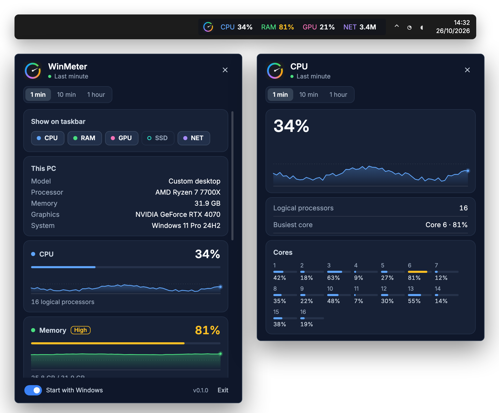

<div align="center">


# WinMeter

**Live CPU, memory, GPU, disk, and network readings on the Windows taskbar.**

A tiny, portable system monitor that sits beside the clock. No installer, no admin rights, no telemetry.

[](https://github.com/imariman/win-meter/releases/latest)
[](https://github.com/imariman/win-meter/releases)


[](LICENSE)

[**Download**](https://github.com/imariman/win-meter/releases/latest/download/WinMeter.exe) ·
[Features](#features) ·
[Usage](#usage) ·
[Build from source](#build-from-source) ·
[Contributing](#contributing)

<br>



</div>

## Features

- **Labeled taskbar strip.** CPU, RAM, GPU, SSD, and NET readings sit next to the notification area, refreshed every second. Pick which ones to show.
- **One click to the details.** Click a reading to open its detail screen, or the logo for the home screen.
- **History you can zoom.** Switch charts between the last minute, the last 10 minutes, and the last hour.
- **Per-core CPU.** See the load on every logical processor and which core is the busiest.
- **At-a-glance warnings.** Readings turn amber at 75% and red at 90%, and the dashboard labels them *High* or *Critical* so color is never the only signal.
- **This PC at a glance.** Model, processor, memory, graphics adapter, and Windows version on the home screen.
- **Portable single file.** One self-contained `WinMeter.exe` with the .NET runtime bundled. Nothing to install.
- **No elevation, no telemetry.** Runs as a normal user, makes no network calls, and keeps every reading on your machine.

## Download

| Asset | Platform | Notes |
| --- | --- | --- |
| [`WinMeter.exe`](https://github.com/imariman/win-meter/releases/latest/download/WinMeter.exe) | Windows 10/11, x64 | Self-contained single file, no .NET install required |

> [!NOTE]
> The executable is not code-signed yet, so Windows SmartScreen may warn you on first launch.
> Choose **More info**, then **Run anyway**.

## Usage

Start `WinMeter.exe`. A strip appears on the taskbar, just left of the notification area. CPU and RAM are shown by default.

| On the strip | Shows | Detail screen |
| --- | --- | --- |
| **CPU** | Total processor load | Chart, logical processors, busiest core, per-core load |
| **RAM** | Physical memory in use | Chart, used, available, total, committed |
| **GPU** | GPU engine load | Chart, adapter name, usage |
| **SSD** | Space used on the system drive | Read + write chart, volume, used, free, capacity |
| **NET** | Download rate of the active adapter | Download chart, adapter, download, upload |

| Action | Result |
| --- | --- |
| Click a reading | Open its detail screen. Click it again to close. |
| Click the logo or right-click the strip | Open the home screen |
| <kbd>Esc</kbd> or click elsewhere | Close the dashboard |

On the home screen you can:

- choose which readings appear on the taskbar,
- switch the chart range between **1 min**, **10 min**, and **1 hour**,
- turn **Start with Windows** on or off,
- **Exit** WinMeter.

The strip hides itself while the taskbar is vertical or auto-hidden.

### Command line

Print a single sample and exit. Handy for scripts and bug reports:

```powershell
WinMeter.exe --once
# cpu=12.4 ram=48.1 disk=61.9 read=0 write=40960 down=1024 up=512 iface=Wi-Fi volume=C: cores=16 gpu=3.0 gpuReady=True
```

Rates are in bytes per second. If there is no console to write to, the line goes to `%TEMP%\winmeter-once.txt` instead.

## How it works

WinMeter samples once per second on a background thread and keeps up to an hour of samples in memory.

| Metric | Source |
| --- | --- |
| CPU | `GetSystemTimes`; per core from `NtQuerySystemInformation` |
| Memory | `GlobalMemoryStatusEx` and commit charge |
| GPU | Performance Data Helper (`pdh.dll`) GPU engine counters |
| Disk space | `DriveInfo` for the drive that holds Windows |
| Disk throughput | Performance Data Helper (`pdh.dll`) counters |
| Network | `System.Net.NetworkInformation`, following the adapter with the default route |
| This PC | Read-only registry values under `HKLM\HARDWARE` and `HKLM\SOFTWARE\Microsoft\Windows NT` |

Taskbar choices are stored per user under `HKCU\Software\WinMeter`. **Start with Windows** uses the standard `HKCU\...\Run` key.

## Build from source

**Requirements:** Windows 10 or 11 and the [.NET 10 SDK](https://dotnet.microsoft.com/download/dotnet/10.0).

```powershell
git clone https://github.com/imariman/win-meter.git
cd win-meter
.\run.ps1
```

`run.ps1` uses a per-user SDK in `%LOCALAPPDATA%\Microsoft\dotnet` when one exists, and falls back to `dotnet` on `PATH`. Arguments after `--` go to the app:

```powershell
.\run.ps1 -- --once
```

Publish the same single-file executable that CI ships:

```powershell
dotnet publish src\WinMeter\WinMeter.csproj -c Release -r win-x64 --self-contained true `
  -p:PublishSingleFile=true -p:IncludeNativeLibrariesForSelfExtract=true -p:EnableCompressionInSingleFile=true `
  -o artifacts\win-meter
.\artifacts\win-meter\WinMeter.exe
```

### Project layout

```text
src/WinMeter/
├── App.xaml(.cs)        Entry point, single-instance guard, --once mode
├── Metrics/             Sampling: CPU, memory, GPU, disk, network, machine profile
├── Tray/                Wires the sampler to the strip and the dashboard
├── Ui/                  Taskbar strip, dashboard window, view model, sparkline
├── AutoStart.cs         "Start with Windows" (HKCU Run key)
└── Format.cs            Byte, rate, and percent formatting
```

### Releasing

Pushing a tag that starts with `v` (for example `v0.2.0`) runs the [release workflow](.github/workflows/release.yml), which builds `WinMeter.exe` on `windows-latest` and attaches it to a GitHub release.

## Limitations

- Temperatures are not shown yet.
- Disk readings cover the system drive only.
- Network readings follow one adapter: the one that carries the default route.
- The strip is placed for a horizontal taskbar at the bottom of the screen.

## Contributing

Issues and pull requests are welcome.

1. Fork the repository and create a branch from `master`.
2. Keep changes focused, and match the style of the surrounding code.
3. Run the app with `.\run.ps1` and check the strip and the dashboard on your machine.
4. Open a pull request that explains what changed and why. Screenshots help for UI changes.

When reporting a bug, include your Windows version, display scaling, taskbar position, and the output of `WinMeter.exe --once`.

## License

WinMeter is released under the [MIT License](LICENSE).
